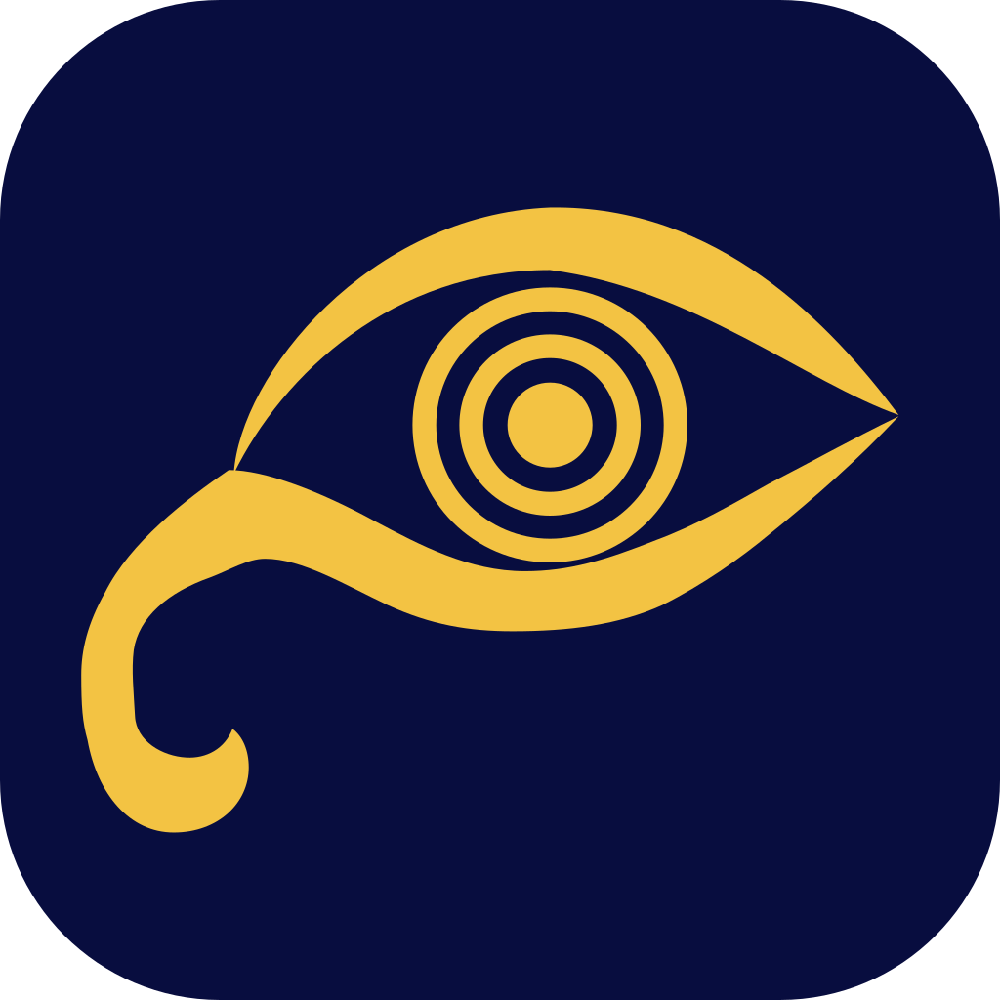
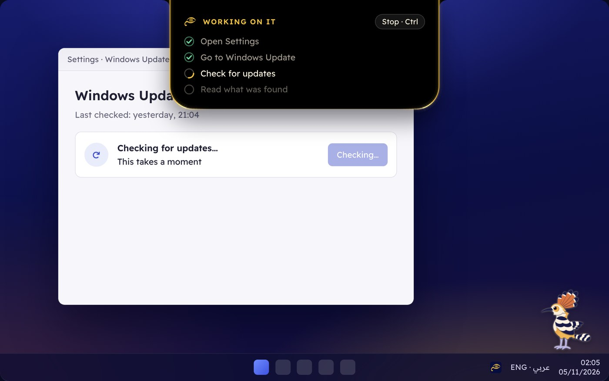

<div align="center">



# Mubsir · مُبصِر

### Your PC, by voice.

**A free voice agent for blind and low-vision people on Windows.**<br>
Hold one key and say what you want, in Arabic, in English, or both in one sentence.<br>
Mubsir reads it, explains it, does it, or teaches you how.

[](https://github.com/dusk-futile/mubsir/releases)
[](LICENSE)


</div>

---

Most AI assistants live in a chat box and tell you what to click. **Mubsir does the clicking**, or teaches you the keys if you'd rather learn. It reads your screen, works your apps, reads your documents and answers out loud.

> ```
> "افتح جوجل وابحث عن مواعيد الصلاة"
> "هات the book on النحو واقرأ من آخر مكان"
> "علمني أقص فيديو خطوة بخطوة"
> "open a new window with the same page"
> ```

## Who it's for

- **If you can't see the screen.** Everything works by voice and Right Ctrl, with sounds and speech, next to the [NVDA](https://www.nvaccess.org/) screen reader. It reads books and scanned Arabic pages, and picks up where you stopped.
- **If you see it with difficulty.** It tells you what's on screen and where things are.

On first start it asks a few questions, and each answer changes how it behaves. If you use a screen reader, it already knows and skips that question.

## What it does

- **It works the whole PC.** Opens apps, sites and files, searches and reads you numbered results, clicks what it can see, scrolls, fills in fields, plays YouTube, manages files, and installs a program when you ask and press a key.
- **It reads what's really there.** Web pages, Word, PDFs and scanned Arabic books.
- **It reads any symbol.** Phonetic writing such as /ʃɪp/ is said sound by sound, and maths and Greek are named.
- **You pick the Arabic voice.** Say "غير الصوت", hear each one, and say its number.
- **It speaks your language.** Egyptian, Gulf, Levantine, Libyan, Maghrebi and MSA, with English mixed in mid-sentence.
- **You stay in control.** One key stops anything, instantly. Sending, paying and deleting need your OK. On bank pages the AI switches off, and you press Pay yourself.
- **It's light.** Everything on screen has a job and can be turned off. It's built for 4 GB PCs.



*The notch shows anyone looking at the screen what Mubsir is doing. You never need to look at it.*

## Getting started

Mubsir is free, and it runs on your own keys, so you pay the AI services only for what you use.

**You need:** 64-bit Windows 10 (22H2) or Windows 11, a microphone, and two keys:

| Key | What it's for | |
| --- | --- | --- |
| [Claude](https://console.anthropic.com/settings/keys) | The brain | Required. Mubsir uses Haiku 5.5: the fastest, cheapest and most reliable fit for this. |
| [Fish Audio](https://fish.audio/app/api-keys) | Hearing you and the Arabic voice | Required for hearing, unless you add a [Google Gemini](https://aistudio.google.com/apikey) key instead. If its voice fails, the free Windows voice takes over. |

English speech is free: Ryan, a natural voice that runs on your PC, downloads once in the background. Arabic speech uses Fish Audio.

**What it might cost a month.** These are estimates for 20 spoken requests a day, not quotes:

| | English | Arabic |
| --- | --- | --- |
| Requests | about $1.20 | about $3.90 |
| 10 book pages a day | free | about $15 |

Opening a book costs nothing. Arabic is only paid for as you listen, about $0.50 for 10 pages, and hearing it again is free. Arabic books can use the free Windows voice instead.

1. Download the latest zip from [Releases](https://github.com/dusk-futile/mubsir/releases) and extract it.
2. Right-click `setup.ps1` → **Run with PowerShell**, as administrator. It adds Arabic speech and the Mubsir Bridge add-on for NVDA, and starts Mubsir when you sign in.
3. Mubsir opens its setup window and talks you through it. Copy a key on the website and it's picked up, tested and stored by itself, encrypted for your Windows account.

## Using it

| Keys | What happens |
| --- | --- |
| Hold **Right Ctrl** | Talk. Release when you're done. |
| **Ctrl** | Stop speaking (same as NVDA). |
| Double-tap **Right Ctrl**, then **Space** | Read from here |
| … then **← / →** | Previous / next sentence |
| … then **↑ / ↓** | Previous / next paragraph |
| … then **Page Up / Page Down** | Previous / next page of a book, with no internet needed |
| … then **.** | Repeat |
| … then **Enter** | Type a request instead of speaking |
| … then **F1** | Help |
| **Right Ctrl** or **Esc** during a task | Stop it |
| **Win + Shift + Esc** | Stop everything, from anywhere |

Settings are in the tray icon's menu.

Things you can say:

```
اقرأ لي الشاشة
افتح جوجل وابحث عن مواعيد الصلاة
مين بعتلي على واتساب؟
الكتاب ده بيتكلم عن إيه؟
scroll down and read the next part
open a new window with the same page
علمني Excel
```

## Your chats

Conversations are saved as plain files you can open, one a day, in `Documents\Mubsir\Chats`. Card numbers and codes are hidden first. You can turn this off in settings, and private mode saves nothing.

## Privacy

- Mubsir only sends something when you ask for it, and only to the services you gave keys for: your voice to Fish Audio or Google for transcription, your request and the screen text it needs to Anthropic, and the Arabic it speaks to Fish Audio. English speech stays on your PC.
- Passwords, card numbers and one-time codes are never sent. Bank and payment pages are handled locally.
- Say "private mode on" to keep everything on your PC.
- Logs contain timings and error codes only, never what you said or read.

## Building from source

You need the [.NET 10 SDK](https://dotnet.microsoft.com/download/dotnet/10.0).

```bash
git clone https://github.com/dusk-futile/mubsir.git
cd mubsir
dotnet build Mubsir.slnx
dotnet publish src/Mubsir.App -c Release -r win-x64 -o publish
python scripts/build-addon.py
```

The core library (`src/Mubsir.Core`) builds on any OS, and `dotnet test tests/Mubsir.Core.Tests` runs its tests. The app itself (`src/Mubsir.App`) runs on Windows only.

On Windows, `Mubsir.exe --overlay-demo` shows the normal-mode notch and Hudhud on their own. It listens to, sends and clicks nothing, and Esc quits.

## License

[MIT](LICENSE). The NVDA add-on in `nvda-addon/` is GPL-2.0, like NVDA itself, and NVDA's controller client is LGPL-2.1. The English voice uses [sherpa-onnx](https://github.com/k2-fsa/sherpa-onnx) (Apache-2.0) with espeak-ng (GPL-3.0). Its voice model, Ryan from [Piper](https://github.com/rhasspy/piper), is trained on [RyanSpeech](https://www.kaggle.com/datasets/roholazandie/ryanspeech), CC BY-NC-SA 4.0, so it can't be used commercially.
